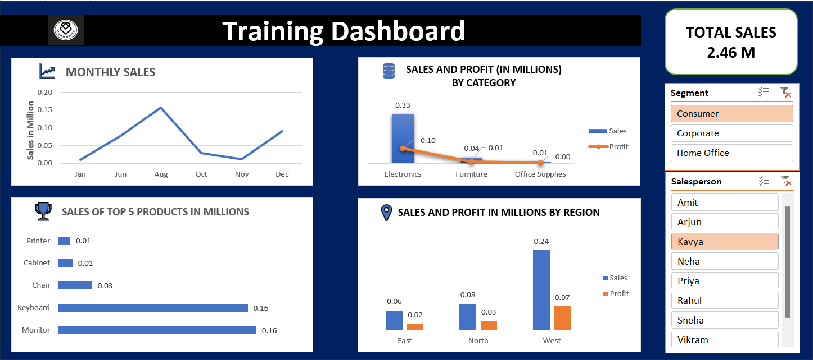

# 📊 Sales Performance Dashboard | Microsoft Excel

## 📌 Project Overview

This project focuses on analyzing sales performance using Microsoft Excel to transform structured sales data into meaningful business insights.

An interactive Sales Performance Dashboard was developed using PivotTables, Excel charts, KPI reporting, and slicers to evaluate revenue, profitability, product performance, and regional sales trends.

The project demonstrates how Excel can support business performance monitoring, sales comparisons, and data-driven decision-making.

---

## 🎯 Business Objectives

The primary objectives of this project are:

- Monitor overall sales performance through KPI reporting.
- Analyze monthly sales trends and fluctuations.
- Compare sales and profit across product categories.
- Evaluate regional sales and profit contributions.
- Identify the top five products based on sales.
- Explore performance through interactive slicers.
- Present sales analysis through a structured visual dashboard.

---

## 📂 Dataset Overview

The project uses structured sales data containing transaction details, product information, customer segments, regional information, and financial metrics.

### Key Data Attributes

| Category | Data Fields |
|----------|-------------|
| Transaction Details | Order ID, Order Date |
| Product Information | Category, Product |
| Geographic Information | Region |
| Customer Information | Segment |
| Sales Information | Salesperson, Units, Unit Price |
| Financial Information | Discount, Sales, Cost |

These attributes support sales trend analysis, regional comparisons, category-level performance evaluation, and profitability reporting.

---

## 🛠️ Tools and Techniques

### Microsoft Excel
Used as the primary platform for sales analysis, reporting, and dashboard development.

### PivotTables
Used to summarize sales data across months, product categories, regions, and products.

### Excel Charts
Used to visually compare sales trends, product rankings, and sales-versus-profit performance.

### Interactive Slicers
Used to filter sales analysis and explore selected portions of the dataset.

### KPI Reporting
Used to summarize sales performance through dashboard metrics.

### Data Organization and Formatting
Applied to structure sales information and improve report readability.

### Git and GitHub
Used for version control, project documentation, and sharing the completed Excel project.

---

## 📸 Dashboard Preview



The dashboard provides a centralized view of sales performance through visualizations, summary metrics, and interactive filtering.

---

## 📈 Dashboard Features

### 1. Total Sales KPI

Displays a summarized sales metric to support business performance monitoring.

### 2. Monthly Sales Analysis

Visualizes sales patterns across different months to support time-based comparisons.

### 3. Category-wise Sales and Profit

Compares revenue and profitability across product categories.

### 4. Regional Sales Performance

Analyzes sales and profit contributions across geographic regions.

### 5. Top 5 Products by Sales

Highlights products generating the highest sales within the selected data.

### 6. Interactive Filtering

Uses slicers to explore sales performance across selected customer segments and salespeople.

---

## 🔍 Business Analysis

The dashboard supports analysis of the following business questions:

### Product Performance
- Which products generate the highest sales?
- Which product categories contribute more revenue?
- How does profitability differ across categories?

### Regional Performance
- How does sales performance vary across regions?
- Which regions contribute more to profitability?

### Monthly Sales Trends
- How does sales performance change over time?
- Which months show stronger or weaker sales activity?

### Customer and Salesperson Analysis
- How do results differ across customer segments?
- How does filtering by salesperson affect reported performance?

**Note:** Dashboard metrics and rankings may change depending on the active slicer selections.

---

## 📁 Project Structure

```text
Sales-Performance-Dashboard/
|
|-- Sales_Performance_Dashboard.xlsx
|-- README.md
|-- .gitignore
|
|-- screenshots/
    |-- sales_dashboard.png
```

---

## 🚀 How to Use

1. Download `Sales_Performance_Dashboard.xlsx` from this repository.
2. Open the workbook in Microsoft Excel.
3. Navigate to the **Dashboard** worksheet.
4. Explore the sales KPI and dashboard charts.
5. Use slicers to filter the displayed results.
6. Open the **Pivots** worksheet to review summarized analysis.
7. Explore the **DATA** worksheet to inspect the underlying sales records.

---

## 💡 Skills Demonstrated

- Microsoft Excel Data Analysis
- PivotTable Reporting
- Sales and Profitability Analysis
- Business KPI Monitoring
- Data Aggregation and Summarization
- Data Visualization
- Interactive Dashboard Development
- Business Performance Analysis
- Git and GitHub Version Control
